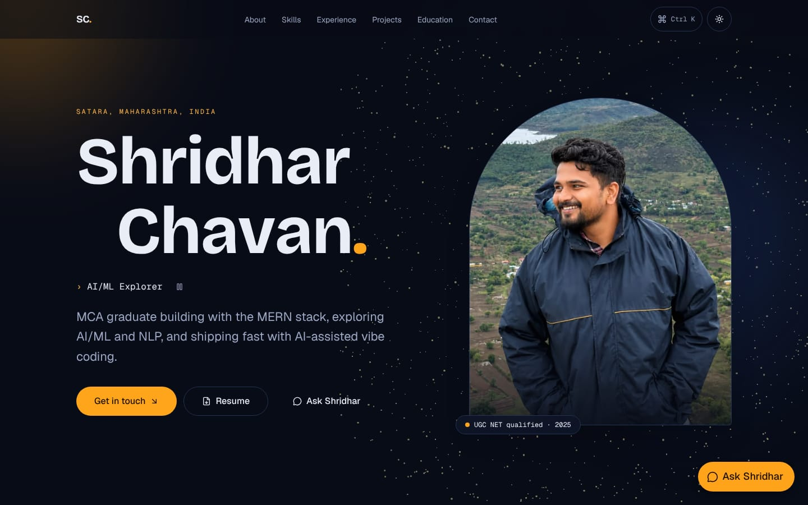
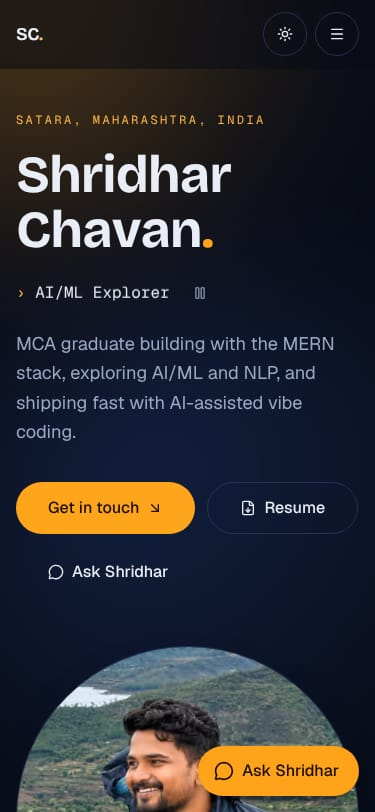

# Shridhar Chavan · Portfolio

An animated MERN portfolio with an **"Ask Shridhar" AI chatbot** that answers questions from the
resume. It is a React 19 single-page app, prerendered to static HTML, with an Express + MongoDB API
and Claude for the chat.



<p align="center"></p>

## Highlights

- **Ember look (v3):** near-black and signal red, a giant name behind a cut-out portrait, a perspective
  grid floor, slanted condensed headlines, a red quote band and a particle sphere by the contact form,
  with a faint Sahyadri ridge and the Marathi name of Satara kept as the personal touch. 3D text: the name
  flips in letter by letter, roles turn on a box, headings tilt upright on scroll, buttons roll on hover,
  numbers roll like an odometer.
- **Motion with restraint:** a one-time preloader, a SplitText hero reveal, scroll-driven sections
  (pinned experience story, horizontal certifications strip, drawn timeline) with GSAP +
  ScrollTrigger and Lenis smooth scroll, a lazy-loaded React Three Fiber particle field, shared-layout
  route transitions with Motion, a custom cursor and magnetic buttons. Everything has a
  `prefers-reduced-motion` fallback, and content is readable without JavaScript.
- **Ask Shridhar chatbot:** streams answers over server-sent events from the Claude API, grounded
  in `shared/profile.json`. NLP intent detection (wink-nlp) refuses off-topic questions and prompt
  injection without calling the model. Logs are anonymised. With no API key, it answers in offline mode.
- **Contact form:** Zod-validated on both sides, honeypot + rate limit, sentiment tagging, saved to
  MongoDB and emailed through Resend.
- **Command palette:** ⌘K / Ctrl+K to jump to sections or projects, switch theme, open the chat,
  copy the email.
- **Fast and accessible:** every route is prerendered and hydrated after the hero image paints.
  Lighthouse mobile scores are 91–96 for performance on the home page, 99–100 on the other pages,
  and 100 for accessibility, best practices and SEO. The site meets WCAG 2.2 AA, checked by axe in
  CI in both themes, and has no layout shift.

## Tech stack

| Layer    | Tools                                                                                                    |
| -------- | -------------------------------------------------------------------------------------------------------- |
| Client   | React 19, Vite 8, TypeScript, Tailwind CSS v4, shadcn/ui-style primitives, React Router                  |
| Motion   | Motion, GSAP + ScrollTrigger + SplitText, Lenis, React Three Fiber + drei                                |
| Server   | Express 5, TypeScript (ESM), Zod, Mongoose, Helmet, CORS, express-rate-limit, wink-nlp                   |
| Services | MongoDB Atlas, Resend (email), Anthropic Claude API (chat)                                               |
| Quality  | ESLint, Prettier, Vitest + Testing Library, supertest, Playwright + axe-core, Lighthouse, GitHub Actions |

## Project structure

```
client/    React app. src/content (resume text) · src/components · src/pages · scripts/prerender.mjs
server/    Express API. src/routes · src/lib (intent, sentiment, llm, mailer) · src/stores (mongo | memory)
shared/    profile.json + projects.json: the single source of resume facts for the UI, API and chatbot
e2e/       Playwright smoke tests with axe accessibility scans
scripts/   optimize-images.mjs (photos → AVIF/WebP/JPEG) · brand-assets.mjs (OG image, icons)
```

`CLAUDE.md` documents the architecture, design tokens and conventions in detail.

## Run it locally

Requires **Node 22+**.

```bash
npm install
cp server/.env.example server/.env   # optional: works with every value left empty
npm run dev                          # site http://localhost:5173 · API http://localhost:4000/api/health
```

With an empty `.env` everything still works. Projects come from `shared/projects.json`, messages
are kept in memory, emails are skipped and the chatbot runs in offline mode. Fill in values only for
the services you want to try.

| Command                                 | What it does                                                               |
| --------------------------------------- | -------------------------------------------------------------------------- |
| `npm run dev`                           | Client (Vite) + API (tsx watch) together; Vite proxies `/api`              |
| `npm run build`                         | Builds the server, then the client (prerendered HTML, sitemap, robots.txt) |
| `npm run preview -w client`             | Serves `client/dist` like the production host (clean URLs, 404, gzip)      |
| `npm run lint` / `typecheck` / `format` | ESLint, TypeScript, Prettier                                               |
| `npm test`                              | Vitest unit tests (client) + API tests with supertest (server)             |
| `npm run e2e`                           | Builds and runs the Playwright smoke suite (desktop + mobile, offline API) |
| `npm run seed -w server`                | Upserts `shared/projects.json` into MongoDB (`-- --prune` removes others)  |
| `npm run images` / `brand`              | Regenerates the optimised photos / the OG image, icons and LinkedIn banner |
| `npm run resume`                        | Renders `client/public/Shridhar_Chavan_Resume.pdf` from the resume JSON    |

## Environment variables

Secrets live only in `server/.env` locally and in the host's dashboard in production. They are
never committed or sent to the browser. See `server/.env.example` and `client/.env.example`.

**Server** (`server/.env`, or Render → Environment)

| Variable             | Required           | Purpose                                                                                         |
| -------------------- | ------------------ | ----------------------------------------------------------------------------------------------- |
| `NODE_ENV`           | prod: `production` | `production` makes `MONGODB_URI` mandatory                                                      |
| `PORT`               | no (4000)          | Hosts set this automatically                                                                    |
| `CLIENT_ORIGIN`      | prod: yes          | Site origin(s) allowed by CORS, comma-separated: `https://your-domain.com,https://x.vercel.app` |
| `MONGODB_URI`        | prod: yes          | MongoDB Atlas connection string                                                                 |
| `RESEND_API_KEY`     | no                 | Enables contact-form emails                                                                     |
| `CONTACT_TO_EMAIL`   | with Resend        | Where contact messages are sent                                                                 |
| `CONTACT_FROM_EMAIL` | with Resend        | Sender on a domain verified in Resend                                                           |
| `ANTHROPIC_API_KEY`  | no                 | Enables the live chatbot (offline answers without it)                                           |
| `CHAT_MODEL`         | no                 | Default `claude-opus-5-5`                                                                       |
| `CHAT_EFFORT`        | no                 | `low` (default) · `medium` · `high`                                                             |
| `LOG_SALT`           | prod: yes          | Random string for hashing visitor IPs in chat logs                                              |
| `TRUST_PROXY`        | no (1)             | Reverse-proxy hops in front of the API, so rate limits see real IPs                             |

**Client** (Vercel → Environment Variables; read at build time, public by design)

| Variable        | Purpose                                                                      |
| --------------- | ---------------------------------------------------------------------------- |
| `VITE_SITE_URL` | Public site URL, e.g. `https://your-domain.com`: canonical, OG tags, sitemap |
| `VITE_API_URL`  | API base URL, e.g. `https://shridhar-portfolio-api.onrender.com`             |

## Deploy

The site is static (Vercel) and the API is a Node service (Render). Both have free tiers. MongoDB
Atlas M0 and Resend are free as well. The Claude API is billed per use, so the chatbot stays in
offline mode until you add a key.

### 1. MongoDB Atlas (database)

1. Create a free **M0** cluster at [cloud.mongodb.com](https://cloud.mongodb.com).
2. **Database Access** → add a user with a generated password.
3. **Network Access** → allow `0.0.0.0/0`. Render's free plan has no fixed outbound IP.
4. **Connect → Drivers** → copy the `mongodb+srv://…` string and add a database name, e.g.
   `…mongodb.net/portfolio?retryWrites=true&w=majority`.
5. Seed the projects once from your machine:
   ```bash
   MONGODB_URI="mongodb+srv://…" npm run seed -w server
   ```

### 2. API on Render

1. [dashboard.render.com](https://dashboard.render.com) → **New → Blueprint** → select this repository.
   Render reads [`render.yaml`](render.yaml).
2. Fill in the prompted values: `MONGODB_URI`, `CLIENT_ORIGIN` (your Vercel URL from step 3; you
   can update it afterwards), and optionally the Resend and Anthropic values. `LOG_SALT` is
   generated for you.
3. When the deploy is live, open `https://<service>.onrender.com/api/health`. It should report
   `"storage":"mongo"`.

On the free plan the service sleeps after 15 idle minutes and the first request takes about
30–60 s. The site stays usable meanwhile, because projects render from the bundled data.

### 3. Site on Vercel

1. [vercel.com/new](https://vercel.com/new) → import this repository. Keep **Root Directory** as the
   repository root. [`vercel.json`](vercel.json) sets the install/build commands, output folder,
   clean URLs, caching and security headers.
2. Add the environment variables `VITE_SITE_URL` (your final domain, or the `*.vercel.app` URL) and
   `VITE_API_URL` (the Render URL), then deploy.
3. Optional: **Settings → Domains** to add a custom domain. Then update `VITE_SITE_URL` and
   redeploy, and add the domain to `CLIENT_ORIGIN` on Render.

Any static host works if it serves `chat/index.html` for `/chat` and `404.html` for unknown paths.
`npm run preview -w client` shows the expected behaviour.

### 4. Optional services

- **Resend:** create an API key at [resend.com](https://resend.com). To send from your own
  address, verify a domain and set `CONTACT_FROM_EMAIL="Portfolio <hello@your-domain.com>"`.
- **Claude chatbot:** create a key at [console.anthropic.com](https://console.anthropic.com), set
  `ANTHROPIC_API_KEY` on Render (never in the client or in git), and consider a monthly spend limit
  in the console. Chat is rate limited to 20 requests per 10 minutes per visitor, and off-topic
  questions never reach the model.

### Railway instead of Render

Create a service from this repository with build command
`npm ci --include=dev && npm run build -w server`, start command `npm run start -w server`,
health check `/api/health`, and the same variables as above.

## Videos

The v2 design has three video slots: a looping hero background, a scroll-scrubbed About clip (hills to
stage) and short project demos on card hover. None ship yet, so the site uses the photos instead. To add
one, see [`assets-raw/video/README.md`](assets-raw/video/README.md). Video never plays for visitors who
prefer reduced motion, use Data Saver or are on a slow connection.

## Content

All resume content lives in `shared/profile.json` and `shared/projects.json`. The site, the API and
the chatbot read from them, so edit facts there once and re-run the seed for MongoDB. Unknown
project details are `TODO` and render as placeholders.

Still to add:

- Live/repository links and case-study details for the projects marked `TODO`.

## Quality checks

`npm run lint`, `npm run format:check`, `npm run typecheck`, `npm test`, `npm run build` and
`npm run e2e` all run in [GitHub Actions](.github/workflows/ci.yml) on every push and pull request.
The Playwright suite runs against the production build on desktop and mobile. It covers the contact
form, chat, command palette, theme persistence, the 404 page and reduced motion, and runs an axe
WCAG 2.2 AA scan on each page.
